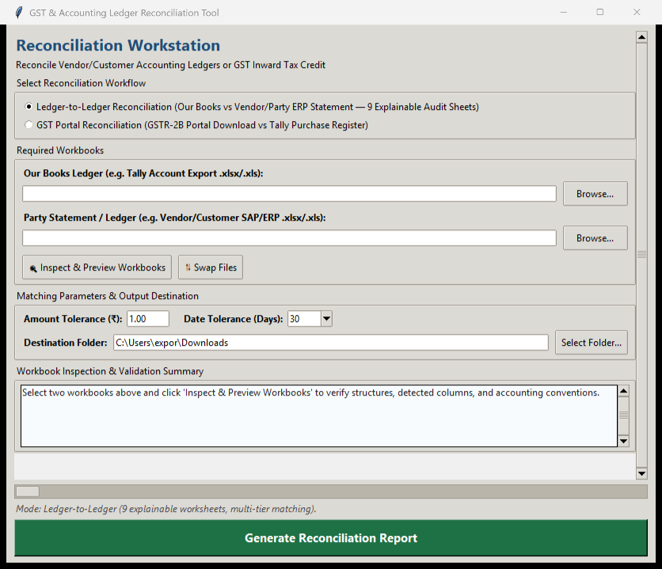
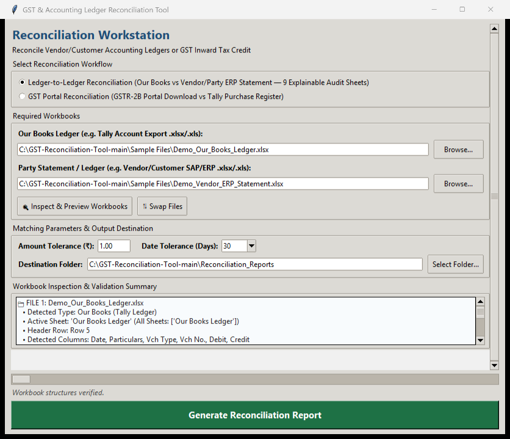
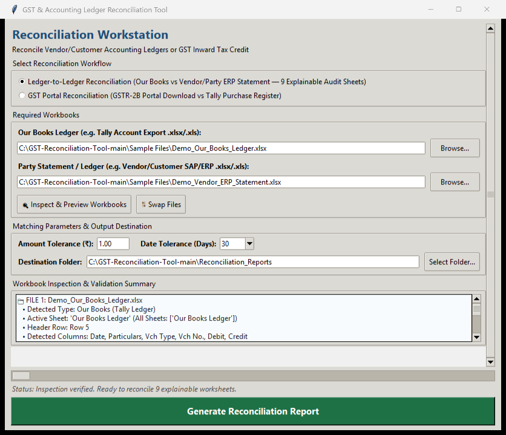
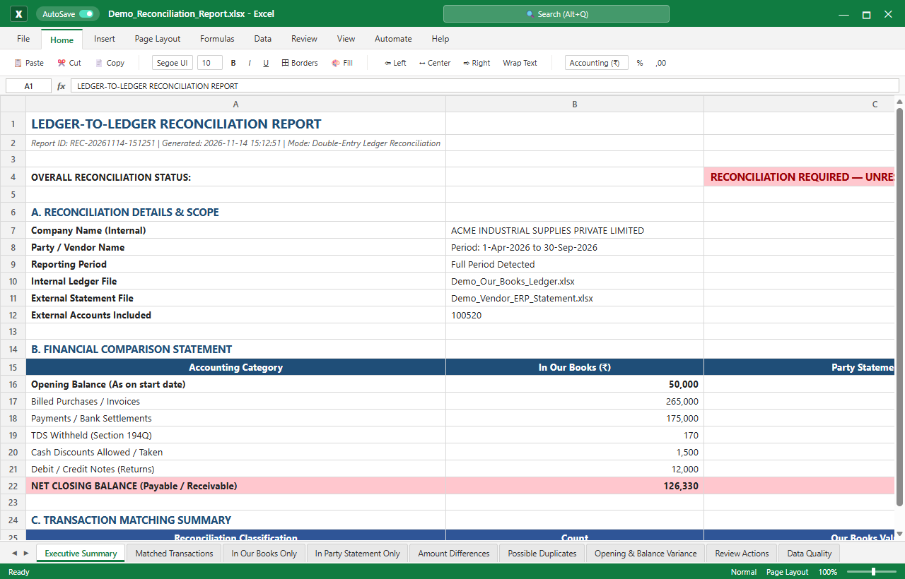
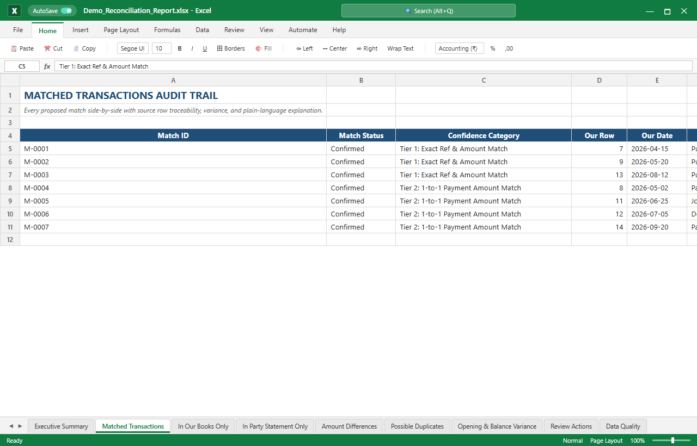
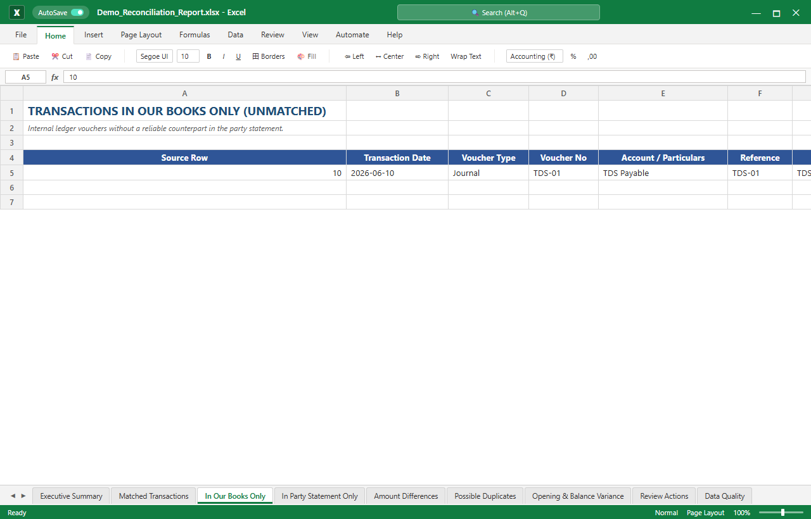
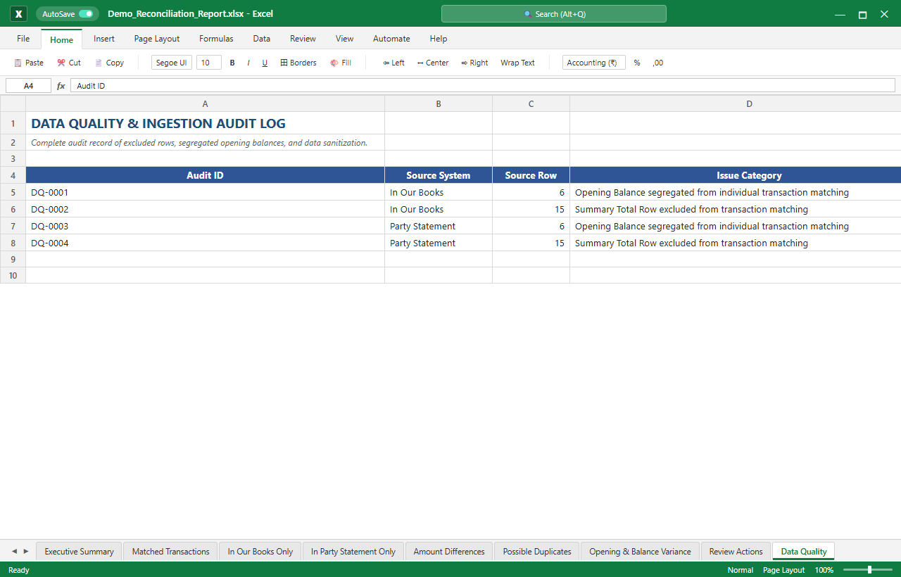
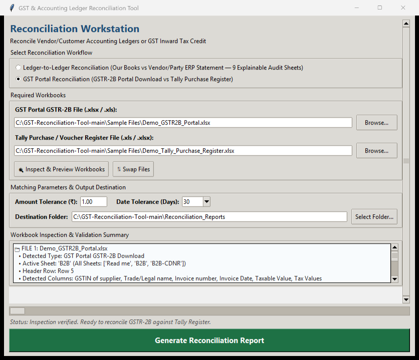

# GST & Accounting Ledger Reconciliation Tool

[](https://github.com/ifeelrohit/GST-Reconciliation-Tool/actions/workflows/windows_build_and_test.yml)
[](LICENSE)
[-lightgrey.svg)](#6-system-requirements)
[](https://github.com/ifeelrohit/GST-Reconciliation-Tool/releases)

---

## ⚡ Quick Start: Run on Windows — No Python Required

> [!IMPORTANT]
> If you are an accountant, auditor, tax consultant, or business owner, you **do not need to install Python or configure any programming environment**. 
> The application is distributed as a pre-compiled, standalone Windows desktop workstation ready for immediate use.

### 3-Step Launch:
1. **Download the ZIP**: Go to the **[Official GitHub Releases](https://github.com/ifeelrohit/GST-Reconciliation-Tool/releases)** and download `GST-Reconciliation-Tool-Windows-x64.zip`.
2. **Extract All**: Right-click the downloaded ZIP file and select **Extract All...**. *(Do not run directly from inside the compressed zip folder).*
3. **Launch**: Double-click `GST-Reconciliation-Tool.exe` inside the extracted folder to start reconciling your data immediately.

---

## 📖 Table of Contents
- [1. What Is This Tool?](#1-what-is-this-tool)
- [2. How to Use: GST Portal Inward ITC Reconciliation (GSTR-2B vs Tally)](#2-how-to-use-gst-portal-inward-itc-reconciliation-gstr-2b-vs-tally)
  - [Step 1: Exporting Your Files](#step-1-exporting-your-files-gst-portal--tally)
  - [Step 2: Reconciling via Desktop GUI](#step-2-reconciling-via-desktop-gui)
  - [Step 3: Reconciling via Command-Line (CLI)](#step-3-reconciling-via-command-line-cli)
  - [The 4-Pass Matching Engine](#the-4-pass-matching-engine)
  - [Accounting Sanity Gates & Controls](#accounting-sanity-gates--controls)
  - [Understanding the 3 GSTR-2B Worksheets](#understanding-the-3-gstr-2b-worksheets)
- [3. How to Use: Ledger-to-Ledger Commercial Reconciliation (Books vs Party Statement)](#3-how-to-use-ledger-to-ledger-commercial-reconciliation-books-vs-party-statement)
  - [Step 1: Exporting Your Files](#step-1-exporting-your-files-ledger-reconciliation)
  - [Step 2: Reconciling via Desktop GUI](#step-2-reconciling-via-desktop-gui-1)
  - [Understanding the 9 Ledger Worksheets](#understanding-the-9-ledger-worksheets)
  - [Accounting Sign Conventions & TDS Section 194Q](#accounting-sign-conventions--tds-section-194q)
- [4. How to Share the Tool With Others (Without Large Email Attachments)](#4-how-to-share-the-tool-with-others-without-large-email-attachments)
- [5. Application Screenshots](#5-application-screenshots)
- [6. System Requirements](#6-system-requirements)
- [7. Privacy, Security & SmartScreen Notice](#7-privacy-security--smartscreen-notice)
- [8. Troubleshooting Common Issues](#8-troubleshooting-common-issues)
- [9. Developer Setup, Tests, and Build Instructions](#9-developer-setup-tests-and-build-instructions)
- [10. Demonstration Workbooks](#10-demonstration-workbooks)
- [11. License and Support](#11-license-and-support)

---

## 1. What Is This Tool?

The **GST & Accounting Ledger Reconciliation Tool** is an audit-grade desktop workstation designed to solve common, time-consuming discrepancies in Indian corporate accounting and tax compliance. 

The software operates two distinct, non-overlapping reconciliation engines:

1. **GST Portal Inward ITC Reconciliation (GSTR-2B vs Tally Purchase Register)**:
   - Reconciles official GST Portal GSTR-2B inward supplies downloads against your internal Tally purchase voucher register.
   - Executes a cascading 4-pass matching algorithm (exact invoice number, partial substring, amount + date with same PAN, and taxable value).
   - Generates an official **ITC Bridge** that mathematically ties internal claimed ITC directly to the GST Portal summary with an exact nil variance (₹0.00 difference).
2. **Ledger-to-Ledger Reconciliation (Books vs Party Statement)**:
   - Reconciles your internal accounting ledger (*"In Our Books"*, e.g., Tally debtor/creditor ledger) against an external statement from a vendor or customer (*"Party Statement"*, e.g., SAP FBL1N/FBL5N, Oracle, or ERP export).
   - Generates an explainable, audit-friendly **9-worksheet Excel reconciliation workbook** with full transaction-level traceability.
   - Segregates complex accounting entries including statutory TDS under Section 194Q, cash discounts, debit/credit notes, grouped payment clearances, and multi-account opening balance variances.

> [!NOTE]
> **Important Distinction**: Ledger-to-Ledger reconciliation verifies commercial balance agreement and cash settlement between trading entities; it does **not** evaluate or determine statutory GST Input Tax Credit (ITC) eligibility under Section 16(2) of the CGST Act. The GST Portal reconciliation mode must be used for GSTR-2B inward tax credit audits.

---

## 2. How to Use: GST Portal Inward ITC Reconciliation (GSTR-2B vs Tally)

Use this workflow for monthly or quarterly GST audits to verify that suppliers have filed their GSTR-1 returns, ensuring you do not lose Input Tax Credit (ITC).

### Step 1: Exporting Your Files (GST Portal & Tally)

#### A. Download Official GSTR-2B from the GST Portal:
1. Log in to the [GST Portal (gst.gov.in)](https://www.gst.gov.in/).
2. Navigate to: **Services** > **Returns** > **Returns Dashboard**.
3. Select your **Financial Year** and **Return Filing Period** (e.g. *October 2026*), then click **Search**.
4. In the **Auto-drafted ITC Statement for the month GSTR-2B** tile, click **Download**.
5. Click **Download Excel** to save the `.xlsx` file (e.g., `GSTR2B_23AAECA2339R1ZH_202610.xlsx`).
   > *Note:* The tool automatically reads sheets `B2B` and `B2B-CDNR` using the official two-row header structure (identified by `"GSTIN of supplier"`). It also checks the portal summary `ITC Available` sheet for verification.

#### B. Export Purchase Register from Tally:
1. Open your company in **TallyPrime** or **Tally.ERP 9**.
2. Go to: **Display More Reports** > **Statutory Reports** > **GST Reports** > **GSTR-3B** (or **Purchase Register**).
3. Set the date period matching your GSTR-2B filing month (`F2: Period`).
4. Press `Alt + E` (Export) > select **Current** > choose **Format: Excel (Spreadsheet)**.
5. Save the `.xlsx` or `.xls` file.
   > *Dynamic Column Detection:* You do not need to rearrange Tally columns manually. The engine dynamically scans the first 60 rows to locate:
   > - `Date`, `Particulars`, `Voucher Type`, `Voucher No.`, `Supplier Invoice No.`, `GSTIN/UIN`
   > - `Value` (Taxable Value) and `Gross Total`
   > - Tax Columns: Automatically recognized when the header contains `CGST`/`SGST`/`IGST` **and** `INPUT` (e.g. `CGST INPUT 9%`, `SGST INPUT 9%`, `IGST INPUT 18%`).
   > - Ledgers like `PURCHASE GST` or `PURCHASE IGST` are treated strictly as expense/purchase ledgers, never as taxes.

---

### Step 2: Reconciling via Desktop GUI

1. Launch `GST-Reconciliation-Tool.exe`.
2. At the top of the window, select the radio button:
   ```
   (•) GST Portal Reconciliation (GSTR-2B Portal Download vs Tally Purchase Register)
   ```
3. In **File 1** and **File 2**, click **Browse...** to select your Tally Purchase Register and GSTR-2B Portal workbook. *(Order does not matter; the tool auto-detects each file's role).*
4. (Optional) Click **🔍 Inspect & Preview Workbooks** to preview detected sheets, header rows, candidate transaction counts, and data sanity checks.
5. Set your tolerances:
   - **Amount Tolerance (₹)**: Default `1.00` (absorbs minor rounding differences).
   - **Date Tolerance (Days)**: Default `30` days.
6. Select your **Destination Folder**.
7. Click the green **Generate Reconciliation Report** button.
8. Once processing finishes, open the resulting `GST_Recon_Report_<Timestamp>.xlsx` in Microsoft Excel.

---

### Step 3: Reconciling via Command-Line (CLI)

For command-line users, automated batch processing, or scheduled cron workflows, you can run the reconciliation engine directly from PowerShell or Command Prompt:

```powershell
python gst_recon.py --tally "path\to\Tally_Purchase_Register.xlsx" --gstr2b "path\to\GSTR2B_Portal.xlsx" --out "GST_Recon_Report.xlsx"
```

#### Available CLI Arguments:
- `--tally <path>`: Path to Tally purchase register Excel workbook (Required).
- `--gstr2b <path>`: Path to official GSTR-2B Excel workbook (Required).
- `--out <path>`: Path for the generated Excel reconciliation report (Default: `GST_Recon_Report.xlsx`).
- `--tol <amount>`: Monetary tolerance in INR (Default: `1.00`).
- `--date-tol <days>`: Document date window in days (Default: `10` days).
- `--quiet`: Suppress terminal summary printing.

---

### The 4-Pass Matching Engine

The reconciliation engine processes documents through a cascading 4-pass match sequence:

| Pass | Method | Matching Criteria | Applied When |
| :---: | :--- | :--- | :--- |
| **Pass 1** | **Exact Match** | Same supplier GSTIN + identical normalized invoice number (`norm_inv`: uppercase, alphanumeric only, leading zeros stripped). | Standard invoice recorded accurately in both systems. |
| **Pass 2** | **Partial Substring Match** | Same GSTIN + invoice number substring contained (minimum 3 characters) + GST difference within $2 \times \text{tolerance}$ (₹2.00). | Tally recorded `1599` while GSTR-2B recorded `2026/351` or `INV-1599`. |
| **Pass 3** | **Amount + Date Match** | Same supplier PAN (characters 3–12 of GSTIN) + GST diff within tolerance (₹1.00) + gross diff within tolerance + ₹0.50 + date within 10 days. | Supplier changed invoice numbering scheme or prefix (e.g. Tally recorded `999`, 2B recorded `26270099HVL00999`). |
| **Pass 4** | **Taxable Value Only Match** | Same supplier PAN + taxable value within tolerance (₹1.00) + date within 10 days + tax amounts differ. | Rate dispute, HSN tax rate discrepancy, or tax classification mismatch. |

---

### Accounting Sanity Gates & Controls

To guarantee that a report is never generated on corrupted or misaligned data, the engine enforces strict sanity controls:

1. **Row Arithmetic Validation**: Validates `Value + Taxes + Round-off = Gross Total` (tolerance ₹1.00). If $>20\%$ of rows fail, the tool **aborts with a `ParseError` (exit code 3)** to prevent misleading reports.
2. **Tax vs Purchase Ledger Isolation**: Only columns containing `CGST`/`SGST`/`IGST` **and** `INPUT` are parsed as taxes. Generic ledgers (such as `PURCHASE GST`, `PURCHASE IGST`, or discount ledgers) are never treated as tax.
3. **Data Cleansing**:
   - Vouchers marked `(cancelled)` in Particulars are automatically excluded.
   - Vouchers under `PURCHASE_EXP` or `RCM/...` are routed to a separate RCM list.
   - Hidden Excel carriage returns (`_x000D_`) and newlines are sanitized.
   - Trailing punctuation (dots/commas) is stripped from voucher numbers while retaining invoice numbers strictly as text.
4. **Official GSTR-2B Portal Tie-Out**: Computes Gross Available ITC minus Credit Notes and compares it directly with the portal's `ITC Available` summary (Part A minus Part B). **The difference must tie out to exactly ₹0.00**.

---

### Understanding the 3 GSTR-2B Worksheets

The generated report `GST_Recon_Report_<Timestamp>.xlsx` consists of three dedicated audit sheets:

#### 1. `Summary` Sheet
- **Status Table**: Document count, Taxable Value, CGST, SGST, IGST, Total GST, and Gross Total for each status category.
- **ITC Bridge Table**: Reconciles Tally Claimed ITC to GSTR-2B Net Available ITC and ties back to the portal's summary sheet:
  $$\text{Tally GST} - \text{Books Only} + \text{2B Only} - \text{Diff} = \text{GSTR-2B Net GST}$$
  $$\text{Portal Tie-Out Difference} = \mathbf{₹0.00}$$
- **Key Audit Findings**: Plain-language commentary highlighting invoice number discrepancies, missing vendor filings requiring GSTR-1 follow-ups, and accounting misclassifications.

#### 2. `Reco Detail` Sheet
- Complete 25-column side-by-side register of every inward transaction.
- Includes: Status, Supplier GSTIN, Trade Name, Tally Vch No., Supplier Inv No., 2B Inv No., Dates, Taxable Values, CGST, SGST, IGST, Total GST, Gross Total.
- **Live Excel Formulas**: Variance columns utilize `=K# - V#` formulas so edits or adjustments automatically update in Excel.
- **Remarks & Actions**: Actionable recommendations (e.g. *"Invoice number format differs; verify with supplier bill"*, *"Follow up with supplier to file GSTR-1"*).
- Styled with Indian Rupee formatting (`₹#,##0.00`), frozen header row, and auto-filters.

#### 3. `Data Quality` Sheet
- Complete audit register logging arithmetic check failures, misclassified purchase ledgers, and excluded cancelled vouchers.
- Provides row numbers, voucher references, and audit explanations.

---

## 3. How to Use: Ledger-to-Ledger Commercial Reconciliation (Books vs Party Statement)

Use this workflow to reconcile commercial balances with your vendors or customers, agree upon closing ledger balances, and clear audit schedules.

### Step 1: Exporting Your Files (Ledger Reconciliation)

#### A. Internal Ledger ("In Our Books"):
- Export your party ledger from Tally, Busy, or your internal ERP for the desired financial period.
- Required columns: `Date`, `Particulars`, `Vch Type`, `Vch No.`, `Debit`, `Credit`.
- *Note:* Company address blocks, header rows, blank lines, and opening balance rows are automatically segregated.

#### B. External Statement ("Party Statement"):
- Obtain the ledger statement from the external party (e.g. SAP FBL1N vendor statement or FBL5N customer statement).
- Required columns: `Assignment`, `Account`, `Document Type`, `Document Number`, `Reference`, `Document Date`, `Amount in local currency`.
- *Note:* Statements consolidating multiple account divisions (e.g. Bangalore and Bhopal billing branches) are automatically separated.

---

### Step 2: Reconciling via Desktop GUI

1. Launch `GST-Reconciliation-Tool.exe`.
2. Select the radio button:
   ```
   (•) Ledger-to-Ledger Reconciliation (Our Books vs Vendor/Party Statement)
   ```
3. Browse and select your internal ledger and the external party statement. *(Smart auto-orientation detects the correct file roles even if selected in reverse).*
4. Click **🔍 Inspect & Preview Workbooks** to review opening balances, transaction counts, and detected column mappings.
5. Set your tolerances (defaults: ₹1.00 and 30 days).
6. Click **Generate Reconciliation Report**.
7. Open `Ledger_Recon_Report_<Timestamp>.xlsx` in Microsoft Excel.

---

### Understanding the 9 Ledger Worksheets

The commercial ledger reconciler produces a 9-worksheet audit workbook:

| Worksheet Name | Contents & Purpose |
| :--- | :--- |
| **1. Executive Summary** | High-level financial table comparing Opening Balances, Purchases, Payments, TDS, Discounts, Notes, and Closing Balances for both sides. Includes commercial status rating and executive takeaways. |
| **2. Matched Transactions** | 29-column side-by-side audit schedule displaying internal voucher details against party statement details, date lag, matching rule applied, review status, and next actions. |
| **3. In Our Books Only** | Internal vouchers without an external counterpart. Classifies items (e.g. Purchase, Payment, Section 194Q TDS Deduction, Cash Discount) and provides plain-English audit reasons. |
| **4. In Party Statement Only** | External statement items not in internal books (e.g. unrecorded vendor invoices, bank clearing entries). Recommends verification steps such as checking Goods Receipt Notes (GRN). |
| **5. Amount Differences** | Transactions correlated by document reference where values diverge beyond tolerance. Displays internal amount, external amount, absolute difference, and percentage variance. |
| **6. Possible Duplicates** | Flags repeated document numbers across rows or identical transaction amounts booked on the same date to identify duplicate entries or payments. |
| **7. Opening & Balance Variance** | In-depth breakdown reconciling opening balance variance, net period movement variance, and closing balance variance: $\text{Opening Var} + \text{Movement Var} = \text{Closing Var}$. |
| **8. Review Actions** | Prioritized action register with Action IDs, issue category, referenced documents, amounts, and step-by-step resolution notes for audit teams. |
| **9. Data Quality** | Complete traceability log of every non-transaction row excluded from the engine (headers, address blocks, summary totals, opening balance rows, blank rows). Guarantees **zero source rows disappear silently**. |

---

### Accounting Sign Conventions & TDS Section 194Q

#### Sign Conventions:
- **Buyer's Books**: Credit = Inward Invoice / Liability (+); Debit = Payment / TDS Withholding / Adjustment (-).
- **Vendor Statement**: Positive = Billed Invoice / Receivable (+); Negative = Payment / Credit Note (-).

#### Statutory TDS (Section 194Q):
TDS deducted by buyers under Section 194Q of the Income Tax Act is automatically classified and segregated. Because vendors bill gross amounts prior to tax withholding, TDS entries appear in `In Our Books Only` with instructions to issue Form 16A TDS certificates to the vendor.

---

## 4. How to Share the Tool With Others (Without Large Email Attachments)

Email providers (such as Gmail or Outlook) frequently block `.exe` files or attachments exceeding 25 MB. To share this tool with colleagues, accountants, or clients easily:

1. **Option 1 (Recommended — Send the Official GitHub Link):**
   Share the permanent direct download link:
   👉 **[https://github.com/ifeelrohit/GST-Reconciliation-Tool/releases/latest](https://github.com/ifeelrohit/GST-Reconciliation-Tool/releases/latest)**  
   The user simply clicks the link and downloads `GST-Reconciliation-Tool-Windows-x64.zip`.

2. **Option 2 (Internal Cloud Drive):**
   Download `GST-Reconciliation-Tool-Windows-x64.zip` and upload it to your company Google Drive, OneDrive, or Dropbox. Share the download link within your team.

3. **Option 3 (Lightweight Python CLI):**
   If sharing with a colleague who has Python installed, you only need to send the single file `gst_recon.py` (~30 KB). They can run:
   ```powershell
   pip install openpyxl
   python gst_recon.py --tally <tally.xlsx> --gstr2b <2b.xlsx>
   ```

---

## 5. Application Screenshots

### 1. Main Application Interface
One-click switching between Ledger-to-Ledger commercial reconciliation and GST Portal Inward ITC audits.


### 2. Pre-Reconciliation Workbook Inspection
Interactive inspection panel validating sheet structures, header detection, candidate rows, and opening balances.


### 3. Ledger-to-Ledger Reconciliation Workflow
Books vs Party Statement setup with demonstration ledgers, customizable tolerance windows, and destination path.


### 4. Executive Summary Worksheet
High-level financial summary featuring commercial status badge, financial movement comparison, and variance analysis.


### 5. Matched Transactions Audit Trail
Side-by-side transaction audit trail displaying matching confidence tiers, applied rules, and verification explanations.


### 6. Unmatched Transactions & Section 194Q TDS Analysis
Internal vouchers requiring accountant review, complete with statutory classification (such as Section 194Q TDS) and recommended next actions.


### 7. Data Quality & Ingestion Audit Log
Source row traceability identifying segregated opening balance lines and excluded summary total rows.


### 8. GST Portal Inward ITC Reconciliation Workflow
GSTR-2B vs Tally purchase register mode matching inward ITC by invoice number, vendor GSTIN, and tax heads.


---

## 6. System Requirements

- **Operating System**: 64-bit Windows 10 or 64-bit Windows 11.
- **Processor / RAM**: Modern x64 processor; minimum 2 GB RAM (4 GB recommended for ledgers > 25,000 rows).
- **Disk Space**: ~100 MB free hard drive space.
- **Spreadsheet Viewer**: Microsoft Excel (2013 or newer), LibreOffice Calc, or Google Sheets to view generated reports. *(Excel is not required to run the tool)*.
- **Network / Internet**: **None required**. The tool operates 100% offline.

---

## 7. Privacy, Security & SmartScreen Notice

- **100% Local Execution**: All computations run locally on your PC. No accounting entries, client names, or financial numbers are transmitted across the network.
- **Spreadsheet Security (CWE-1236 Formula Injection Protection)**: External text starting with `=`, `+`, `-`, or `@` is automatically sanitized with a leading `'` to prevent DDE formula execution in Excel.
- **Windows SmartScreen Notice**: Because this application is an open-source project without an expensive commercial code-signing certificate, Windows SmartScreen may show:
  > *"Windows protected your PC — Microsoft Defender SmartScreen prevented an unrecognized app from starting."*
  
  **To Proceed:** Click **More info**, then click **Run anyway**. You can verify file authenticity by checking the cryptographic hash against `SHA256SUMS.txt`.

---

## 8. Troubleshooting Common Issues

| Issue | Cause | Solution |
| :--- | :--- | :--- |
| **"Permission denied" / Output cannot be written** | The previous report is currently open in Microsoft Excel. | Close the workbook in Microsoft Excel before clicking *Generate Reconciliation Report*. |
| **Windows SmartScreen / Smart App Control** | Unsigned open-source binary. | Click *More info* > *Run anyway*, or launch via `Run-GST-Tool.bat` in the project root. |
| **"Could not locate header row"** | File format does not match expected headers. | Click *🔍 Inspect & Preview Workbooks* to check headers. Ensure Tally export has `Date`, `Particulars`, `Voucher No.`, `Gross Total` or Party statement has `Assignment`, `Account`, `Document Number`, `Amount`. |
| **Generate Button Missing on Laptop** | High DPI scaling (125% or 150%) on smaller laptop screens. | The action bar is permanently pinned at the bottom. Scroll down using your mousewheel or resize/maximize the window. |
| **Numbers formatted as text** | ERP exported amounts with currency symbols or commas. | The application cleanses and converts strings like `₹ 1,23,456.00` into numeric values automatically. |

---

## 9. Developer Setup, Tests, and Build Instructions

### Prerequisites
- Windows 10 or 11 (64-bit)
- Python 3.12 (64-bit)
- Git

### Build from Source
```powershell
# 1. Clone repository
git clone https://github.com/ifeelrohit/GST-Reconciliation-Tool.git
cd GST-Reconciliation-Tool

# 2. Setup virtual environment
py -3.12 -m venv .venv
.\.venv\Scripts\Activate.ps1

# 3. Install dependencies
pip install --upgrade pip
pip install -r Requirements.txt

# 4. Run automated test suite (36 tests)
python -m unittest discover tests -v

# 5. Build standalone Windows executable
pyinstaller --noconfirm --clean --onefile --windowed `
    --name "GST-Reconciliation-Tool" `
    --paths "src" `
    --hidden-import openpyxl `
    --hidden-import pandas `
    --hidden-import xlrd `
    --hidden-import reconcile `
    --hidden-import ledger_recon `
    --hidden-import gst_recon `
    src\gst_recon_gui.py
```

---

## 10. Demonstration Workbooks

Sample demonstration files with **no confidential or real taxpayer data** are provided in the [`Sample Files/`](Sample%20Files/) folder:

- [`Demo_Our_Books_Ledger.xlsx`](Sample%20Files/Demo_Our_Books_Ledger.xlsx): Fictional Tally-style ledger with purchases, payments, TDS 194Q, cash discounts, and debit notes.
- [`Demo_Vendor_ERP_Statement.xlsx`](Sample%20Files/Demo_Vendor_ERP_Statement.xlsx): Fictional SAP/ERP statement demonstrating matched pairs and unmatched adjustments.
- [`Demo_GSTR2B_Portal.xlsx`](Sample%20Files/Demo_GSTR2B_Portal.xlsx): Synthetic GSTR-2B inward supplies return.
- [`Demo_Tally_Purchase_Register.xlsx`](Sample%20Files/Demo_Tally_Purchase_Register.xlsx): Synthetic Tally voucher register.

---

## 11. License and Support

- **License**: Released under the [MIT License](LICENSE).
- **Issue Tracker**: Submit bug reports or questions on the [GitHub Issue Tracker](https://github.com/ifeelrohit/GST-Reconciliation-Tool/issues).
